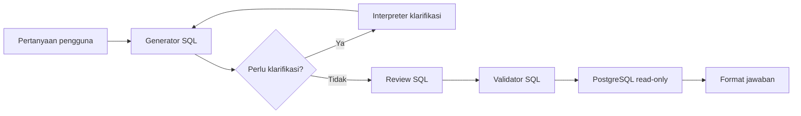

# BizPilot AI

**Tanyakan data bisnis dengan bahasa sehari-hari.** BizPilot AI mengubah pertanyaan menjadi query PostgreSQL, memvalidasi query, menjalankannya pada database, lalu menyajikan hasil dalam bahasa yang mudah dibaca.


## Daftar Isi

- [Fitur](#fitur)
- [Cara Kerja](#cara-kerja)
- [Teknologi](#teknologi)
- [Persiapan](#persiapan)
- [Instalasi](#instalasi)
- [Konfigurasi](#konfigurasi)
- [Menjalankan](#menjalankan)
- [Contoh Pertanyaan](#contoh-pertanyaan)
- [Struktur Proyek](#struktur-proyek)
- [Keamanan dan Batasan](#keamanan-dan-batasan)
- [Pemecahan Masalah](#pemecahan-masalah)

## Fitur

- Mengubah pertanyaan bisnis berbahasa Indonesia atau Inggris menjadi SQL PostgreSQL.
- Meminta klarifikasi saat definisi metrik belum jelas.
- Meninjau logika bisnis dan memperbaiki query yang gagal.
- Memvalidasi query sebelum eksekusi: satu query `SELECT`, tabel yang diizinkan, dan batas hasil.
- Menjalankan query dalam transaksi read-only dengan batas waktu.
- Menggunakan template deterministik untuk beberapa metrik yang sudah didefinisikan.

## Cara Kerja



## Teknologi

| Komponen | Teknologi |
| --- | --- |
| Bahasa | Python 3.10+ |
| Database | PostgreSQL |
| ORM dan koneksi | SQLAlchemy, Psycopg 3 |
| Validasi SQL | SQLGlot |
| Model lokal | Ollama dengan `qwen2.5:3b` |

## Persiapan

Siapkan hal-hal berikut sebelum menjalankan aplikasi:

1. Python 3.10 atau lebih baru.
2. PostgreSQL yang aktif dan dapat diakses.
3. Database berisi tabel dan kolom sesuai definisi di [`app/database/schema.py`](app/database/schema.py).
4. Ollama terpasang dan model `qwen2.5:3b` sudah tersedia.

> **Catatan:** Proyek ini belum menyertakan skrip untuk membuat tabel atau mengimpor dataset. Siapkan database dan datanya terlebih dahulu.

## Instalasi

Jalankan perintah berikut dari direktori proyek.

### Windows PowerShell

```powershell
python -m venv .venv
.\.venv\Scripts\Activate.ps1
python -m pip install --upgrade pip
pip install -r requirements.txt
```

### macOS atau Linux

```bash
python3 -m venv .venv
source .venv/bin/activate
python -m pip install --upgrade pip
pip install -r requirements.txt
```

Unduh model Ollama:

```bash
ollama pull qwen2.5:3b
```

Pastikan layanan Ollama berjalan saat aplikasi digunakan.

## Konfigurasi

Buat file `.env` di direktori utama proyek:

```env
DB_HOST=localhost
DB_PORT=5432
DB_NAME=bizpilot
DB_USER=bizpilot_reader
DB_PASSWORD=ganti_dengan_password_database
```

`DB_PASSWORD` wajib diisi. Nilai host, port, nama database, dan pengguna memiliki nilai default di kode; atur semuanya secara eksplisit untuk lingkungan Anda. File `.env` sudah tercantum di `.gitignore`, jadi jangan commit kredensial ke GitHub.

Gunakan akun database dengan izin baca saja. Aplikasi juga meminta PostgreSQL menjalankan koneksi dalam mode read-only dan menetapkan `statement_timeout` 10 detik.

## Menjalankan

Aktifkan virtual environment, lalu jalankan dari direktori utama proyek:

```bash
python -m app.main_sql
```

Ketik pertanyaan pada prompt. Jika BizPilot meminta klarifikasi, jawab sesuai cakupan analisis yang diinginkan. Aplikasi akan menampilkan SQL, hasil query, dan jawaban.

## Contoh Pertanyaan

```text
Berapa jumlah seluruh pesanan pada 2017?
```

```text
Untuk setiap bulan pada 2017, berapa persentase pesanan delivered yang terlambat?
```

```text
Tampilkan 10 kategori produk dengan revenue tertinggi pada 2017. Hitung revenue dari harga item, tidak termasuk ongkir.
```

```text
Untuk setiap state pelanggan, berapa persentase pelanggan unik yang memiliki minimal dua pesanan delivered pada 2017?
```

## Struktur Proyek

```text
app/
├── agents/
│   ├── answer_generation.py   # Format hasil dan jawaban bisnis
│   ├── clarification.py       # Interpretasi jawaban klarifikasi
│   ├── query_templates.py     # Query deterministik untuk metrik tertentu
│   ├── sql_agent.py           # API publik dan façade layanan agent
│   ├── sql_executor.py        # Eksekusi query
│   ├── sql_generation.py      # Pembuatan, review, dan perbaikan SQL
│   ├── sql_parsing.py         # Parsing respons model
│   ├── sql_prompts.py         # Prompt dan konfigurasi model
│   └── sql_validator.py       # Validasi struktur dan keamanan SQL
├── database/
│   ├── connection.py          # Konfigurasi koneksi PostgreSQL
│   └── schema.py              # Skema dan aturan bisnis untuk model
└── main_sql.py                # Alur CLI aplikasi
```

## Keamanan dan Batasan

- Validator hanya menerima satu query `SELECT` dan membatasi tabel ke daftar yang diizinkan.
- Query hasil baris dibatasi maksimal 100 baris; query juga memiliki batas waktu eksekusi 10 detik.
- Koneksi database dikonfigurasi read-only. Tetap gunakan akun PostgreSQL yang hanya memiliki izin baca.
- Model lokal dapat salah memahami metrik atau klarifikasi. Periksa SQL dan cakupan filter sebelum memakai hasil untuk keputusan bisnis.
- Template deterministik hanya mencakup metrik tertentu; pertanyaan lain diproses oleh model dan bisa memerlukan klarifikasi.

## Pemecahan Masalah

| Gejala | Yang perlu diperiksa |
| --- | --- |
| `DB_PASSWORD must be set` | Pastikan `.env` berada di direktori utama dan `DB_PASSWORD` terisi. |
| Koneksi PostgreSQL gagal | Periksa status PostgreSQL, host, port, nama database, pengguna, dan hak akses. |
| Model Ollama tidak tersedia | Jalankan `ollama pull qwen2.5:3b` dan pastikan layanan Ollama aktif. |
| Query menghasilkan data kosong | Periksa rentang tanggal, status, dan ketersediaan data pada tabel terkait. |
| Query SQL gagal | Periksa SQL yang ditampilkan, lalu pastikan nama tabel dan kolom cocok dengan database. |

---

<p align="center">Dibuat untuk membantu menjelajahi data bisnis dengan bahasa yang lebih natural.</p>
